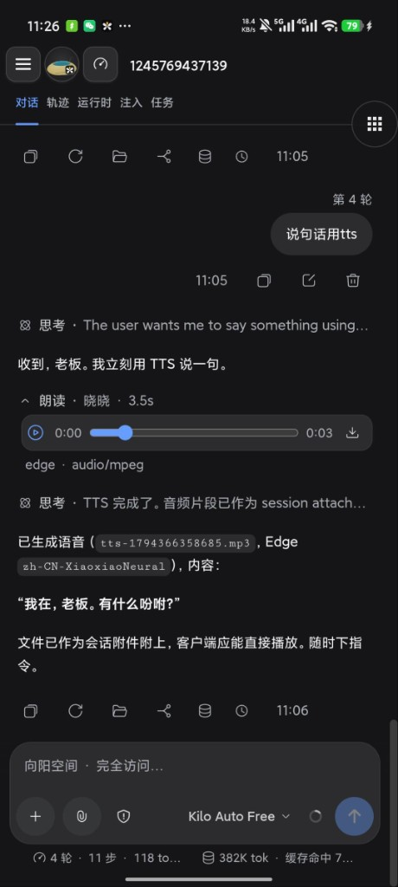
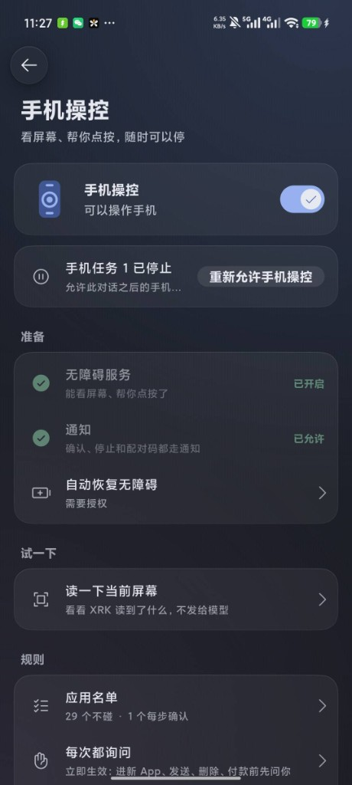

<p align="center">
  <a href="README.md">简体中文</a> · <b>English</b>
</p>

<div align="center">

# XRK Harness · Mobile

**[XRK-Harness](https://github.com/xrkseek/XRK-harness) on your phone.**

<p>
A local-first Android client: run <code>xrkh</code> on-device, or connect to a Host on your computer.<br/>
<strong>Current App release: <code>0.7.17</code></strong>
(first App release <code>0.7.16</code>; application id <code>com.xrkseek.harness</code>; same number as main-repo harness-cli)
</p>

<p>
  <a href="https://github.com/xrkseek/XRK-harness-mobile/releases/tag/v0.7.17"></a>
  
  
  <a href="LICENSE"></a>
  <a href="https://github.com/xrkseek/XRK-harness-mobile"></a>
</p>

<p><em>With respect to <strong>DSH Go</strong> — the phone-side open-source practice in the <a href="https://github.com/deepseek-ai/deepseek-harness">DeepSeek Harness</a> lineage. This repo follows that path and wires in XRK-Harness.</em></p>

</div>

<p align="center">
  
  &nbsp;&nbsp;
  
</p>

<p align="center">
  <sub>Left: on-device chat and TTS · Right: phone control (screen + taps, stop anytime)</sub>
</p>

---

<div align="center">

## Download

Application id <code>com.xrkseek.harness</code> · on a phone use the <strong>arm64</strong> APK

<p>
  <a href="https://github.com/xrkseek/XRK-harness-mobile/releases/latest"></a>
</p>

| Item | Convention | Example |
| --- | --- | --- |
| tag | `v` + version | `v0.7.17` |
| APK | `xrk-harness-<version>-arm64.apk` | `xrk-harness-0.7.17-arm64.apk` |
| Manifest | `update.json` on the same Release | `…/latest/download/update.json` |

</div>

See [docs/release.md](docs/release.md) · [user guide](docs/guide/README.md) · [changelog](docs/changelog.md)

## What this is

| Layer | Role |
| --- | --- |
| **Shell** | Flutter / Kotlin — launch, permissions, files, notifications, updates |
| **On-device engine** | `@xrkseek/harness-cli` (`xrkh`) in proot; home `/root/.xrk` |
| **Chat UI** | Host web shell inside the guest (same family as desktop) |

Shares Host contracts with desktop and CLI. The download page can surface from the main repo [`apps/site`](https://github.com/xrkseek/XRK-harness/tree/main/apps/site).

## Features

- On-device Ubuntu + Node + `xrkh` (no Root)
- Remote Host on a computer or server
- Chat, tool approvals, attachments, voice (including TTS)
- **Phone control** (with permission; stop anytime)
- Themes, icons, pets; optional phone files at guest `/sdcard`

## Install

Android 8.0+. Install the arm64 APK from Releases, set up the on-device runtime or a remote host, configure a model, then chat. Keep about 1 GB free for the local engine.

## Build from source

Linux x86_64 (on Windows use the ASCII build tree; see skill `xrk-mobile-apk` in the main repo):

```bash
git clone https://github.com/xrkseek/XRK-harness-mobile.git
cd XRK-harness-mobile
bash tooling/setup-toolchain.sh && source tooling/env.sh
bash runtime/build-runtime.sh arm64-v8a
bash tooling/build-apk.sh -f arm64 --keep-daemon
```

Output: `app/build/app/outputs/flutter-apk/app-arm64-release.apk`.

## Layout

| Path | Contents |
| --- | --- |
| `app/` | Flutter shell and Android Kotlin |
| `packages/` | Host / Remote Dart clients |
| `runtime/` | guest rootfs, bridge, engine patches |
| `sdk/` · `examples/` | plugin author kit and samples |
| `docs/` | product and maintainer docs |
| `tooling/` | toolchain and APK build |

## Acknowledgements

This project acknowledges **DSH Go** (DeepSeek Harness on phone) for the open-source practice and engineering path it established. Engine and product contracts live in [XRK-Harness](https://github.com/xrkseek/XRK-harness); upstream harness: [deepseek-ai/deepseek-harness](https://github.com/deepseek-ai/deepseek-harness).

## Contributing

Issues and pull requests are welcome — see [CONTRIBUTING.en.md](CONTRIBUTING.en.md). For security issues, follow [SECURITY.en.md](SECURITY.en.md).

## License and copyright

- First-party code: [AGPL-3.0](LICENSE); `sdk/` and `examples/` are MIT.
- Product name **XRK Harness** (`com.xrkseek.harness`). Copyright covers this repository’s own code and marks — **not** DeepSeek / predecessor-brand official character art.
- Engine contracts live in [XRK-Harness](https://github.com/xrkseek/XRK-harness). Third-party code, fonts, icons, and bundled components: [THIRD_PARTY_NOTICES.md](THIRD_PARTY_NOTICES.md).

---

<p align="center">向阳而生，驭光而行</p>
