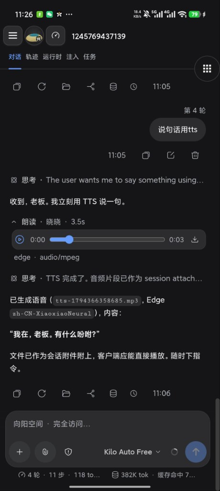
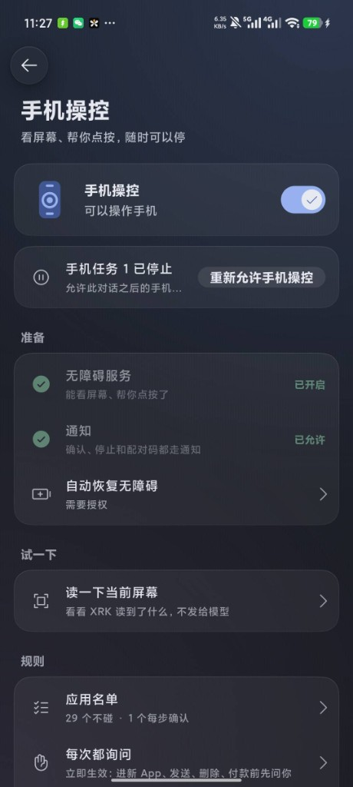

<p align="center">
  <b>简体中文</b> · <a href="README.en.md">English</a>
</p>

<div align="center">

# XRK Harness · 手机版

**把 [XRK-Harness](https://github.com/xrkseek/XRK-harness) 装进手机。**

<p>
本地优先的 Android 客户端：本机跑 <code>xrkh</code>，也能连电脑上的 Host。<br/>
<strong>App 首发 / 现行版本：<code>0.7.16</code></strong>
（包名 <code>com.xrkseek.harness</code>；与主仓 harness-cli 同号）
</p>

<p>
  <a href="https://github.com/xrkseek/XRK-harness-mobile/releases/tag/v0.7.16"></a>
  <a href="https://github.com/xrkseek/XRK-harness-mobile/releases/tag/v0.7.16"></a>
  
  
  <a href="LICENSE"></a>
  <a href="https://github.com/xrkseek/XRK-harness-mobile"></a>
</p>

<p><em>致敬 <strong>DSH Go</strong>（<a href="https://github.com/deepseek-ai/deepseek-harness">DeepSeek Harness</a> 手机端一脉）——本仓在其工程路径上接入 XRK-Harness。</em></p>

</div>

<p align="center">
  
  &nbsp;&nbsp;
  
</p>

<p align="center">
  <sub>左：机内对话与语音 · 右：手机操控（授权后可读屏、点按，随时停）</sub>
</p>

---

<div align="center">

## 下载

包名 <code>com.xrkseek.harness</code> · 真机请用 <strong>arm64</strong> APK

<p>
  <a href="https://github.com/xrkseek/XRK-harness-mobile/releases/latest"></a>
</p>

| 项 | 约定 | 例子 |
| --- | --- | --- |
| tag | `v` + 版本名 | `v0.7.16` |
| APK | `xrk-harness-<版本>-arm64.apk` | `xrk-harness-0.7.16-arm64.apk` |
| 清单 | 同 Release 的 `update.json` | `…/latest/download/update.json` |

</div>

发版约定见 [docs/release.md](docs/release.md) · 使用说明见 [docs/guide/](docs/guide/README.md) · 变更见 [docs/changelog.md](docs/changelog.md)

## 这是什么

| 层 | 作用 |
| --- | --- |
| **壳** | Flutter / Kotlin：启动、权限、文件、通知、更新安装 |
| **机内引擎** | proot 里的 `@xrkseek/harness-cli`（`xrkh`），家目录 `/root/.xrk` |
| **对话 UI** | 机内 Host 的 Web 壳（与 Desktop 同源） |

与桌面 / CLI 共用 XRK-Harness Host 契约。下载页可由主仓 [`apps/site`](https://github.com/xrkseek/XRK-harness/tree/main/apps/site) 露出。

## 可以做什么

- 本机安装 Ubuntu + Node + `xrkh`（免 Root）
- 连接电脑 / 服务器上的 Host
- 聊天、工具审批、附件与语音（含 TTS）
- **手机操控**（授权后可读屏、点按；随时停）
- 主题、图标、桌宠；可选访问手机文件（guest `/sdcard`）

## 安装

需要 Android 8.0+。从 Releases 装 arm64 包 → 首次引导里装本机运行环境或只连远程 → 配好模型再聊。本机引擎大约预留 1 GB。

## 从源码构建

Linux x86_64（Windows 用 ASCII 构建树，见主仓 skill `xrk-mobile-apk`）：

```bash
git clone https://github.com/xrkseek/XRK-harness-mobile.git
cd XRK-harness-mobile
bash tooling/setup-toolchain.sh && source tooling/env.sh
bash runtime/build-runtime.sh arm64-v8a
bash tooling/build-apk.sh -f arm64 --keep-daemon
```

产物：`app/build/app/outputs/flutter-apk/app-arm64-release.apk`。

## 目录

| 路径 | 内容 |
| --- | --- |
| `app/` | Flutter 壳与 Android Kotlin |
| `packages/` | Host / Remote Dart 客户端 |
| `runtime/` | guest rootfs、桥接、引擎补丁 |
| `sdk/` · `examples/` | 插件作者工具与示例 |
| `docs/` | 产品与维护文档 |
| `tooling/` | 工具链与 APK 构建 |

## 致谢

本项目致敬并受益于 **DSH Go**（DeepSeek Harness 手机端）的开源实践与工程路径；引擎与产品契约以 [XRK-Harness](https://github.com/xrkseek/XRK-harness) 为准，上游 harness 见 [deepseek-ai/deepseek-harness](https://github.com/deepseek-ai/deepseek-harness)。

## 开发与贡献

欢迎 Issue 与 Pull Request，见 [CONTRIBUTING.md](CONTRIBUTING.md)。安全问题请按 [SECURITY.md](SECURITY.md) 私密报告。

## 许可证与版权

- 自有代码默认 [AGPL-3.0](LICENSE)；`sdk/`、`examples/` 为 MIT。
- 产品名 **XRK Harness**（`com.xrkseek.harness`）。版权主张覆盖本仓自有代码与标识，**不包括** DeepSeek / 前身品牌官方美术立绘。
- 引擎契约以 [XRK-Harness](https://github.com/xrkseek/XRK-harness) 为准。第三方代码、字体、图标与随包组件见 [THIRD_PARTY_NOTICES.md](THIRD_PARTY_NOTICES.md)。

---

<p align="center">向阳而生，驭光而行</p>
